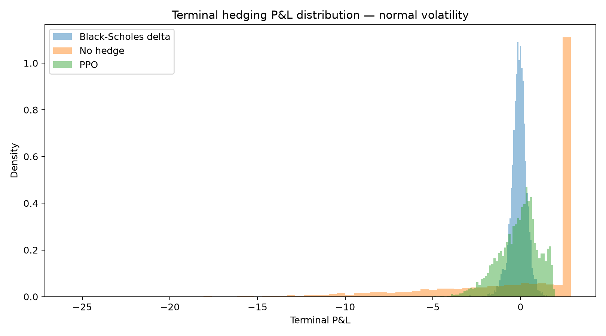
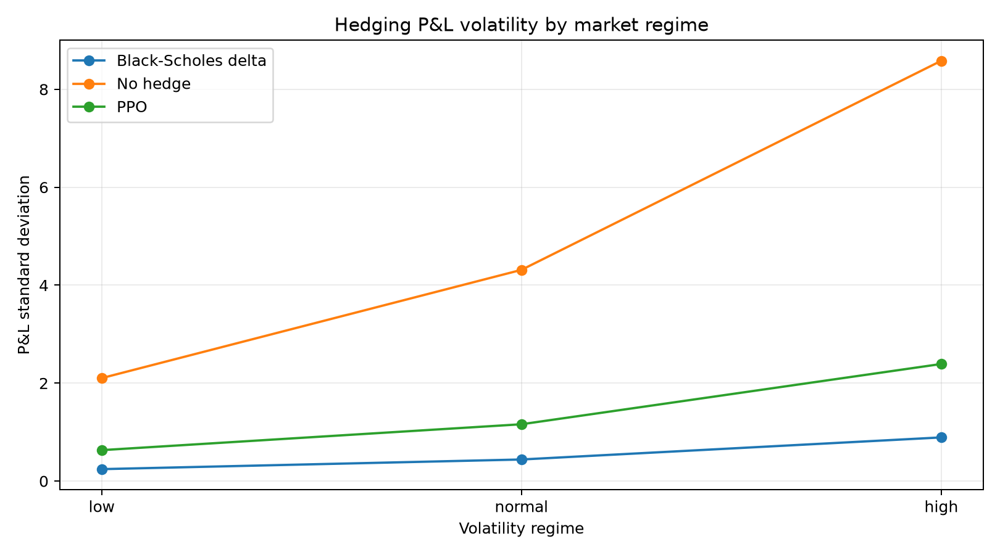

# DeepHedge RL

<p align="center">
  
</p>

<p align="center">
  <strong>Deep Reinforcement Learning for Risk-Sensitive Option Hedging</strong><br>
  PPO • Black–Scholes Benchmark • Transaction Costs • Risk Analysis
</p>

<p align="center">
  
  
  
  
</p>

## Overview

**DeepHedge RL** is a quantitative finance research project that investigates whether deep reinforcement learning can dynamically hedge a short European call option while accounting for transaction costs.

The project trains a **Proximal Policy Optimization (PPO)** agent and benchmarks it against:

- Black–Scholes delta hedging
- An unhedged portfolio

The experiments use simulated risk-neutral Geometric Brownian Motion (GBM) paths and evaluate performance across low-, normal-, and high-volatility regimes.

> **Research prototype only.** Results are based on synthetic market simulations. This project is not a production trading system or financial advice.

## Research question

Can a PPO agent reduce terminal hedging risk while accounting for proportional transaction costs, compared with classical Black–Scholes delta hedging?

## Key features

- Risk-neutral GBM market simulator
- Black–Scholes European call pricing and delta
- Custom Gymnasium hedging environment
- Continuous hedge-ratio actions
- PPO training using Stable-Baselines3
- Proportional transaction costs
- PPO, delta hedge, and no-hedge comparisons
- Low-, normal-, and high-volatility experiments
- CSV evaluation outputs and visualizations
- Unit tests and reproducible random seeds

## Methodology

### Market simulation

The underlying asset follows a risk-neutral geometric Brownian motion:

\[
dS_t = rS_t\,dt + \sigma S_t\,dW_t
\]

### Portfolio

The portfolio starts short one European call option. The initial option premium is received, and the agent trades the underlying stock to hedge the option liability.

### Reinforcement learning agent

The PPO agent observes market and portfolio information, including:

- Normalized spot price
- Moneyness
- Time to maturity
- Volatility
- Black–Scholes delta
- Previous hedge ratio

It selects a continuous target hedge ratio between zero and one.

### Reward design

The environment uses a terminal quadratic penalty on terminal P&L as a practical risk-sensitive training proxy.

This is not an exact implementation of the variance objective in the Deep Hedging research literature. See the limitations section before interpreting the results.

## Experimental configuration

| Parameter | Value |
|---|---:|
| Initial spot | 100 |
| Strike | 100 |
| Maturity | 30 trading days |
| Risk-free rate | 2% |
| Low volatility | 10% |
| Normal volatility | 20% |
| High volatility | 40% |
| Transaction cost | 10 bps |
| PPO training steps | 150,000 |
| Evaluation paths per regime | 5,000 |

## Results

The final evaluation covers 5,000 simulated paths in each of three volatility regimes.

### Normal-volatility regime (20%)

| Strategy | Mean P&L | P&L Std. Dev. | Mean Absolute P&L | Mean Transaction Cost |
|---|---:|---:|---:|---:|
| PPO | -0.137455 | 1.160586 | 0.909756 | 0.250822 |
| Black–Scholes delta | -0.102200 | 0.441073 | 0.338432 | 0.222972 |
| No hedge | -0.036622 | 4.313260 | 3.362974 | 0.000000 |

### P&L distribution



### Risk comparison across regimes



### Results across all regimes

| Regime | Strategy | Mean P&L | P&L Std. Dev. |
|---|---|---:|---:|
| Low (10%) | PPO | -0.153061 | 0.631785 |
| Low (10%) | Black–Scholes delta | -0.104050 | 0.243923 |
| Low (10%) | No hedge | 0.009334 | 2.101992 |
| Normal (20%) | PPO | -0.137455 | 1.160586 |
| Normal (20%) | Black–Scholes delta | -0.102200 | 0.441073 |
| Normal (20%) | No hedge | -0.036622 | 4.313260 |
| High (40%) | PPO | -0.186825 | 2.391594 |
| High (40%) | Black–Scholes delta | -0.124455 | 0.891972 |
| High (40%) | No hedge | 0.293606 | 8.583248 |

### Interpretation

1. PPO substantially reduces P&L volatility compared with the unhedged portfolio in all three regimes.
2. Black–Scholes delta achieves lower P&L standard deviation and mean absolute P&L than PPO in all three regimes.
3. PPO incurs slightly higher average transaction costs than delta hedging in all three regimes.
4. These experiments do not demonstrate PPO outperforming classical delta hedging.

**Important:** PPO was trained at 20% volatility. The low- and high-volatility experiments evaluate transfer of the learned policy; they are not separate training runs.

The results are useful as a baseline for further research, not as evidence of a profitable trading strategy.

## Installation

Python 3.10 or newer is recommended.

### Windows PowerShell

```powershell
git clone https://github.com/poornachandrag659-cloud/deephedge-rl.git
cd deephedge-rl

py -3.11 -m venv .venv
.\.venv\Scripts\Activate.ps1

python -m pip install --upgrade pip
python -m pip install -e ".[dev]"
```

### macOS / Linux

```bash
git clone https://github.com/poornachandrag659-cloud/deephedge-rl.git
cd deephedge-rl

python3 -m venv .venv
source .venv/bin/activate

python -m pip install --upgrade pip
python -m pip install -e ".[dev]"
```

## Run the project

### Run tests

```bash
python -m pytest -v
```

### Train PPO

```bash
python -m deephedge.train --timesteps 150000 --volatility 0.20
```

### Evaluate across volatility regimes

```bash
python -m deephedge.evaluate --paths 5000
```

### Launch the dashboard

```bash
streamlit run app.py
```

## Repository structure

```text
deephedge-rl/
├── .github/
│   └── workflows/
├── assets/
│   └── deephedge-rl-banner.png
├── models/
│   └── ppo_reward_v4.zip
├── results_v4/
│   ├── metrics_by_regime.csv
│   ├── path_results.csv
│   ├── pnl_distribution_normal.png
│   └── pnl_risk_by_regime.png
├── src/
│   └── deephedge/
│       ├── market.py
│       ├── env.py
│       ├── baselines.py
│       ├── train.py
│       ├── evaluate.py
│       └── plots.py
├── tests/
│   ├── test_market.py
│   └── test_env.py
├── app.py
├── pyproject.toml
├── README.md
├── CITATION.cff
└── LICENSE
```

## Limitations and future work

- Constant volatility within each experiment
- PPO trained at the normal-volatility setting by default
- Terminal quadratic reward is a proxy, not a batch variance optimizer
- No stochastic volatility, jumps, discrete dividends, borrow costs, market impact, or liquidity constraints
- Synthetic simulation performance does not establish live-market profitability

Potential research extensions:

- Train using batch-level variance or a convex risk measure such as CVaR
- Add stochastic volatility and jump-diffusion models
- Investigate transaction-cost sensitivity
- Compare policies across multiple training seeds
- Test generalization across additional market regimes

## Research references

1. Bühler, H., Gonon, L., Teichmann, J. & Wood, B. (2019). *Deep Hedging*. Quantitative Finance.
2. Kolm, P. N. & Ritter, G. (2019). *Dynamic Replication and Hedging: A Reinforcement Learning Approach*. The Journal of Financial Data Science.
3. [Deep Hedging reference implementation](https://github.com/hansbuehler/deephedging)
4. [AI4Finance FinRL](https://github.com/AI4Finance-Foundation/FinRL)

## License

This project is released under the MIT License. Referenced research projects retain their own licenses.

## Author

**Poorna Chandra G**

GitHub: [@poornachandrag659-cloud](https://github.com/poornachandrag659-cloud)

---

If you find this project useful, consider giving the repository a star or opening an issue with suggestions for further experiments.
